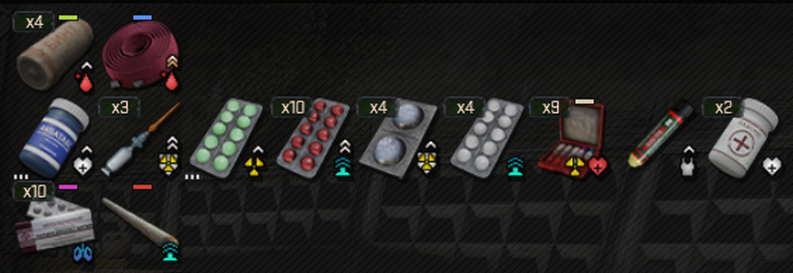
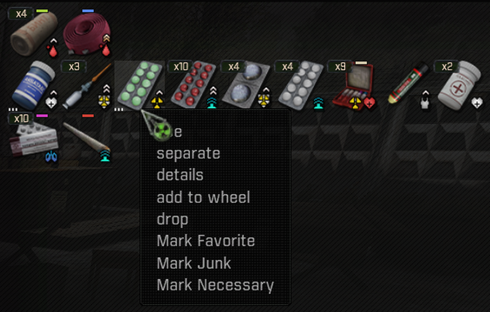

# Necessary Items

An inventory mod for the S.T.A.L.K.E.R. Anomaly modpack G.A.M.M.A. It adds a
**Mark Necessary** entry to the inventory context menu, next to SortingPlus's
Favorite and Junk. Every item of a marked type then stays in your inventory
during bulk and automatic transfers. You can still move, drop or sell a marked
item one at a time when you mean to part with it.

- **Per item type:** marking one medkit marks every medkit of the same kind.
  Each save keeps its own marks.
- **Protected actions:** the Move all button of a loot or stash screen, a
  stack's move all and drop all, GAMMA's Fast Transfer, companion Give All,
  SortingPlus's automatic junk selling, the Unusable Parts Handler and, with a
  magazine mod, Quick Release.
- **Coloured tab:** items show a short tab on their inventory cell: green for
  Favorite, red for Junk, bone for Necessary, blue for Favorite + Necessary and
  magenta for Junk + Necessary.
- **Favorite and Junk:** they keep sorting as before, and the mod adds no sort
  category and never re-sorts your inventory. While it is enabled,
  SortingPlus's **Block "Move all" for Favorites** option, on in GAMMA's
  default settings, has no effect; mark those types Necessary instead.
- **No options and no overwritten files:** its MO2 priority does not matter.

## Screenshots

*Tabs on marked item types, row by row: green Favorite, blue Favorite + Necessary, bone Necessary, magenta Junk + Necessary, red Junk. Unmarked items have none.*

*Mark Necessary in the item's context menu, next to SortingPlus's Favorite and Junk.*

## Download

Download the `.7z` from
[Releases](https://github.com/Q4ln/GAMMA-Necessary-Items/releases/latest), not
"Source code", and install it with Mod Organizer 2's **Install Mod** button.

## Documentation

Requirements, installation, compatibility, saves, known issues, the changelog
and credits are in
[Necessary Items - README.md](https://github.com/Q4ln/GAMMA-Necessary-Items/blob/main/Necessary%20Items%20-%20README.md),
which also ships inside the archive.

Apart from this page and its screenshots, the repository holds exactly the
files the release archive installs.

## Licence

Necessary Items' own code is by Q4ln under CC BY-NC-SA 4.0; see
[Necessary Items - LICENSE.txt](https://github.com/Q4ln/GAMMA-Necessary-Items/blob/main/Necessary%20Items%20-%20LICENSE.txt).
The third-party mods it integrates with remain under their authors' terms.
